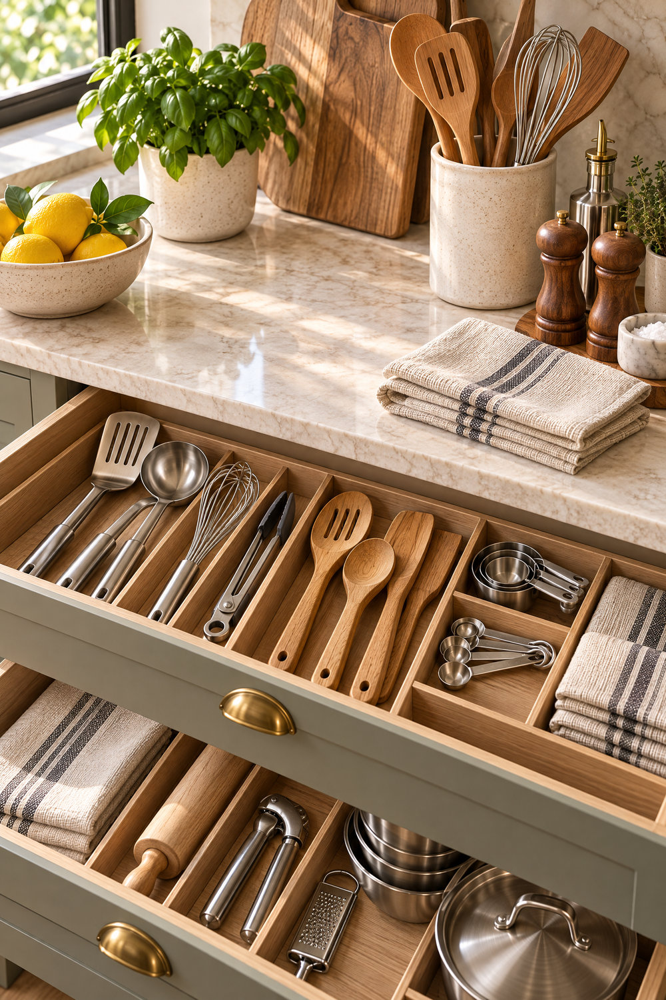
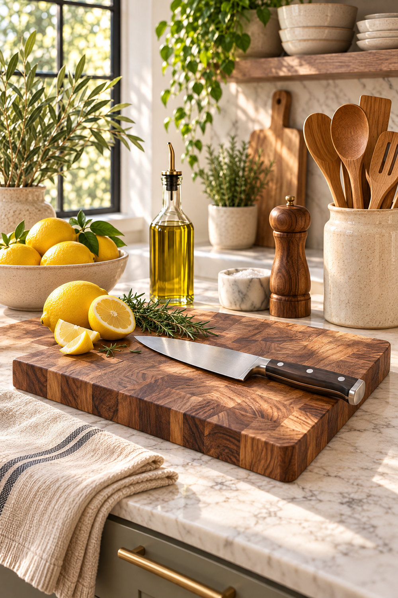
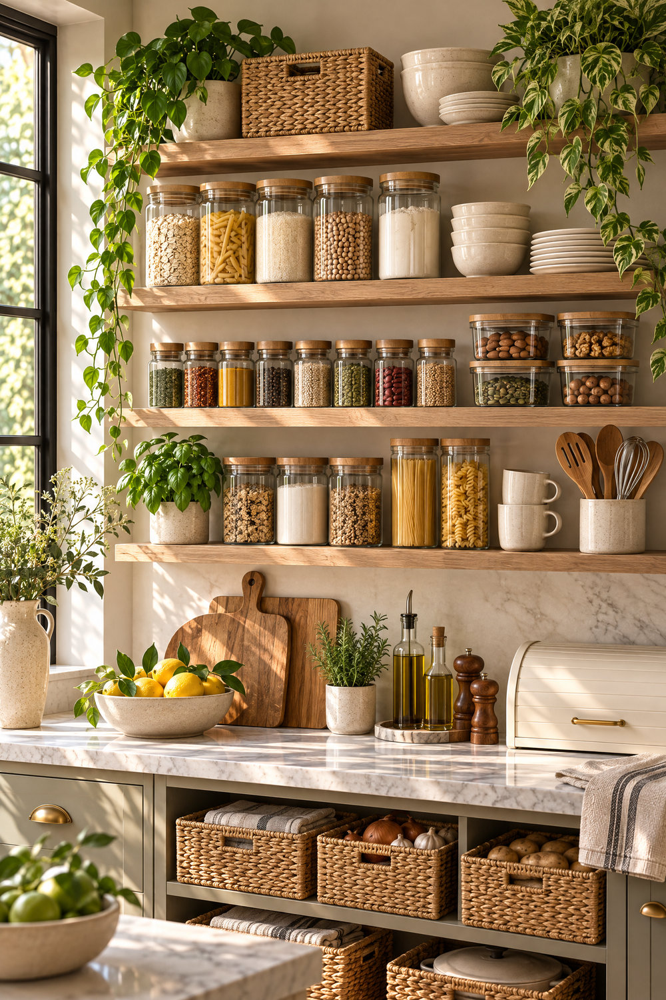
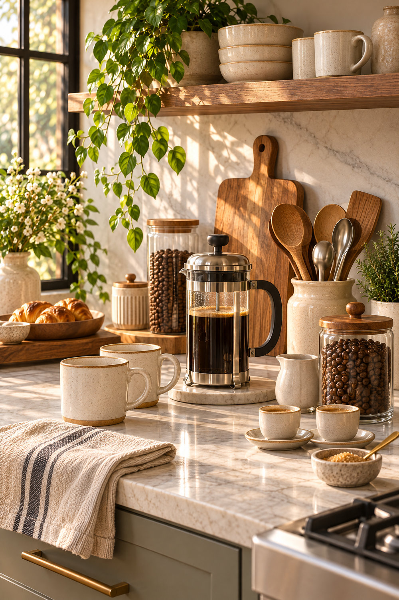
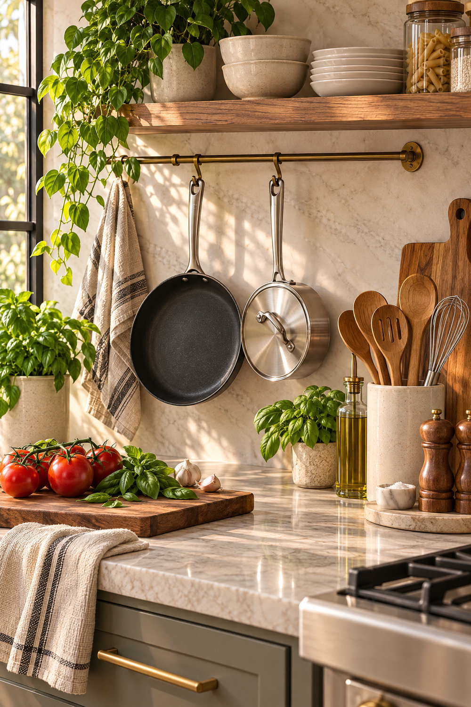
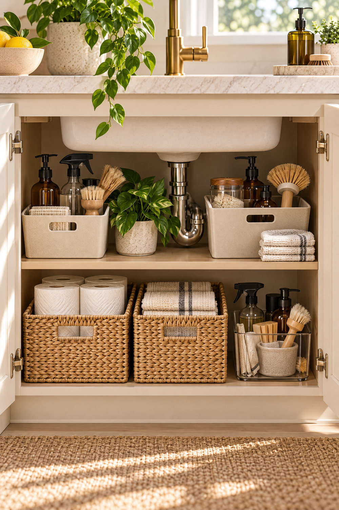

A warm kitchen can look beautiful and still make weekday cooking surprisingly difficult. A whisk is hidden behind three appliances, spices are too far from the hob, the coffee corner spills across the main preparation space, and the pantry contains so many matching jars that nobody can find the original expiry dates.

The solution is not to buy every gadget marketed as a kitchen essential. It is to **give each frequent task one practical home**. The pictures in this guide show one consistent, warm kitchen style in different arrangements; use them as *planning examples*, not as proof that a particular product fits your cabinets or routine.

## The five everyday kitchen zones

Start by watching how the kitchen is actually used for two or three days. List the tasks, where each begins, and what needs to be reached without crossing the room. Most homes benefit from five overlapping zones:

1. **Preparation:** cutting board, knife storage, frequently used utensils, measuring tools and a clean work surface.
2. **Cooking:** suitable pans, spatulas, cooking oils, seasonings and safe landing space beside the hob.
3. **Drinks and breakfast:** kettle or coffee equipment, cups, tea or coffee supplies and a small serving area.
4. **Washing and cleaning:** sink, drying or dishware storage, cloths and securely stored cleaning products.
5. **Pantry and replenishment:** dry foods, baskets, containers and a simple method for checking what needs replacing.

The zones should follow actual tasks, not an idealised showroom photograph. A tiny galley kitchen may share a counter between coffee and prep; a large kitchen may have separate stations. The goal is less unnecessary movement and easier cleaning.

## Prep surfaces: make the frequently used tools easy to reach

The most useful kitchen essential is often **uninterrupted counter space**. Keep enough room for a cutting board and ingredients; then choose which tools deserve to remain visible.

A simple wooden-utensil crock may be helpful near the preparation area. Keep spatulas and spoons grouped by use, rather than mixing them with specialist gadgets that come out once a month. Store sharp knives securely and appropriately, not loose in a crowded drawer. Put heavy cutting boards where they can be lifted safely and will not slide onto an edge.

When choosing a new board, look for a stable working size, a food-safe material, a cleaning method that fits your routine and a place to dry it fully. Attractive timber boards can add visual warmth, but their maintenance and food-use suitability matter more than the look of the grain.

### The simplest utensil-drawer test

Empty one drawer and sort its contents into *daily use*, *occasional use* and *duplicates or damaged*. Return the daily essentials first, with enough room to remove each tool without snagging another. Dividers help only when their compartments match the actual tools and the drawer can still close. Measure internal width, depth and height before ordering an organiser.

A good starting option is an <a href="https://steynenslin.s.gy/drawer-dividers" target="_blank" rel="sponsored noopener noreferrer">adjustable drawer-divider system</a>, provided its dimensions fit and it can be cleaned easily.

## A pantry that is easy to restock

Glass jars and wicker baskets create a calm, attractive pantry, but they are not a substitute for food-storage habits. Group like with like: breakfast foods, cooking staples, baking supplies and backups. Place everyday items at an accessible height and seldom-used supplies away from the prime reach zone.

Use suitable, clean, food-safe airtight containers where they genuinely make storage easier. Keep original packaging details, expiry or best-before dates, and allergen or cooking instructions available; transfer them to a durable label or keep the packaging if necessary. Do not combine new food with old stock simply to fill a jar.

Baskets can corral sealed packets or table linens, but check that their weave is easy to clean and does not trap spills. Tall jars on open shelves also need stable placement and safe lifting access.

### Spice drawer versus exposed spice shelf

A well-divided spice drawer makes labels visible and often keeps containers farther from direct sunlight, steam and cooking heat. The best location is where seasonings are useful *without* putting a drawer directly in the hottest or wettest area. Confirm clearance from the oven and other heat sources, and label by contents, not just matching jars. If the drawer layout is awkward, a small accessible cupboard may work better than an expensive insert.

## A coffee or breakfast station without clutter

A small drink station can be as simple as a kettle, a few mugs and a tray. A French press or coffee machine belongs where there is enough room for making drinks, handling hot water safely, cleaning the equipment and storing any beans or filters.

Choose one practical landing place for cups, not a decorative arrangement that consumes all the preparation counter. Keep electrical appliances away from splashes and use outlets as intended; never route cords across the sink or hot cooking areas.

A breakfast tray is useful when it contains the things needed for one routine—perhaps cups, napkins and a small serving bowl. It becomes clutter when it holds unrelated display items that must be moved before every meal.

## Cooking oils, cookware and an accessible cooking zone

Place a small, manageable set of frequently used tools near preparation and cooking, while keeping oils and other products away from excessive heat and direct sun as directed by their packaging. A tray can make wiping the counter easier, but no tray should block the hob's required clearances or ventilation.

When displaying cookware, think about the **weight and mounting** as well as appearance. Heavy pots need a secure rated support. Hanging pans must not obstruct a work route, a cabinet door or the cook's reach. Open displays also require regular cleaning.

A mixed set of everyday pans may work better than a uniform decorative collection. Compare the cooktop compatibility, weight, handle temperature, dimensions and cleaning instructions of each piece before buying.

## Under-sink storage: organise around plumbing and safety

The space beneath a sink can hold useful equipment, but pipes, disposal fittings, shut-off valves and moisture may make a standard organiser unsuitable. Measure the clear interior around plumbing **with the doors fully open**. Choose a tray or pull-out that can be removed for leak inspection, cleaning and access to valves.

Cleaning chemicals should remain in their **original, labelled containers**, stored securely away from children, pets and food. Do not combine products, and avoid moving hazardous liquids into unlabelled decorative jars. Check the specific material and manufacturer instructions for cleaners used on natural stone, timber and metal finishes.

For awkward cabinets, an <a href="https://steynenslin.s.gy/under-sink-organizer" target="_blank" rel="sponsored noopener noreferrer">under-sink slide-out organiser</a> is one option to compare after confirming the real available cabinet dimensions and the installation requirements.

## When open shelves help—and when they do not

Open shelving works best for objects that are used, returned and cleaned often: a few plates, mugs and a manageable utensil crock. It can be less practical for greasy cooking areas or homes that generate substantial dust. The styling may look effortless, but exposed dishware needs a cleaning routine.

Check wall construction, mounting hardware, shelf weight ratings and reach before placing stacked ceramics or glass jars overhead. It is fine to combine one attractive display shelf with closed, easy-to-access storage for the rest.

Fresh herbs by a window can make a kitchen inviting, but plant placement should respect light, watering, hygiene and food-preparation space. Position pots so drainage water cannot reach food or electrical equipment. A few herbs used often are more practical than a window full of neglected plants.

## Everyday kitchen essentials worth evaluating

These are categories to consider, not a shopping list everyone should buy:

| Item | Reason it might help | What to verify before buying |
| --- | --- | --- |
| Drawer dividers | Make frequently used tools easy to find | Interior drawer dimensions, cleanability, clearance |
| Cutting board | Protects the surface and supports food preparation | Stable size, food safety, cleaning and storage |
| Utensil holder | Groups daily-use tools near prep | Capacity, easy cleaning, position away from heat |
| Pantry containers | Make dry-food storage easier where appropriate | Food-safe seal, original label and date tracking |
| Small oil/seasoning tray | Keeps a tiny cooking zone tidy | Safe placement, heat exposure, wipe-clean surface |
| Cookware organiser | Protects cookware and improves access | Load rating, pot dimensions, installation |
| Under-sink pull-out | Uses awkward cabinet depth | Plumbing, moisture, maintenance and secure chemical storage |
| Coffee-station tray | Keeps one morning routine together | Available counter and safe hot-water operation |

For deep cupboards, compare a <a href="https://steynenslin.s.gy/pull-out-cabinet" target="_blank" rel="sponsored noopener noreferrer">pull-out cabinet organiser</a> with simply relocating your most-used items to an existing, easier-to-reach drawer. You may not need to buy an accessory at all.

*Product links above may be affiliate links. If you buy through them, Veluce may earn a commission; the recommendations are based on practical relevance, not a requirement to purchase.*

## A 15-minute countertop reset

1. Remove items from **one** preparation surface, keeping anything hot or in use safe.
2. Identify what you touch every day versus what has simply accumulated.
3. Put the everyday tools back where the work actually happens.
4. Move rarely used tools into suitable storage; retain one clear landing space.
5. Check whether the arrangement still works with drawers, cupboard doors and appliances open.
6. Live with the new placement for a week before buying any new storage product.

Take a photo of the result from the doorway. Does the kitchen still have a useful work surface, a logical sequence between sink and cooking, and clear access to the things used most often? Those questions matter more than whether every container matches.

## Connect the essentials to your kitchen plan

The best storage solution still depends on the wider layout. If a fridge door blocks the pantry cabinet, no set of baskets will solve that. If the main preparation counter is too small, an elaborate coffee bar might make things worse.

Use the [Veluce Kitchen Design and Layout Guide](/article/kitchen-design-layout/) to check work zones, appliance-door openings and circulation. Before buying or specifying more expensive cabinetry, the [Room Procurement System](/room-procurement-system/) can help structure dimensions, finish comparisons and sourcing decisions. For broader planning, the [Designer Brief Builder](/designer-brief-builder/) helps turn daily routines and constraints into a clearer project brief.

## Explore More

**Browse the VELUCE shop →** [VELUCE Collection](https://tr.ee/Sp8jyc)

**Save ideas for later →** [VELUCE on Pinterest](https://www.pinterest.com/steynenslin/)
