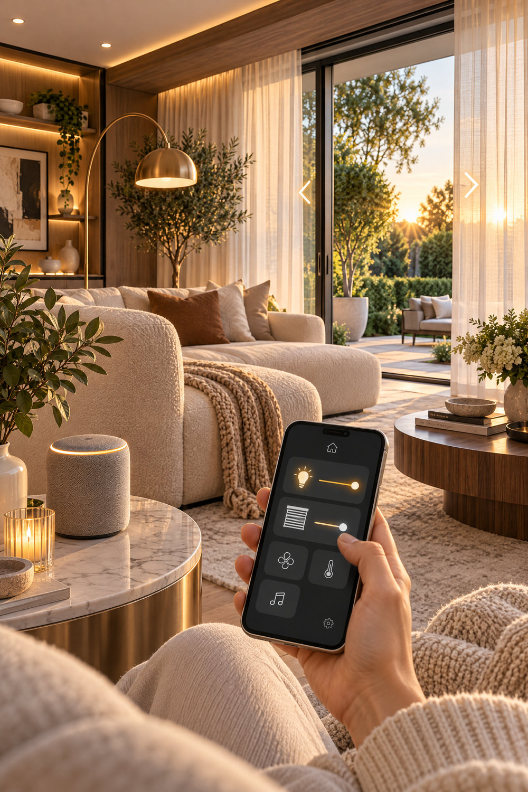
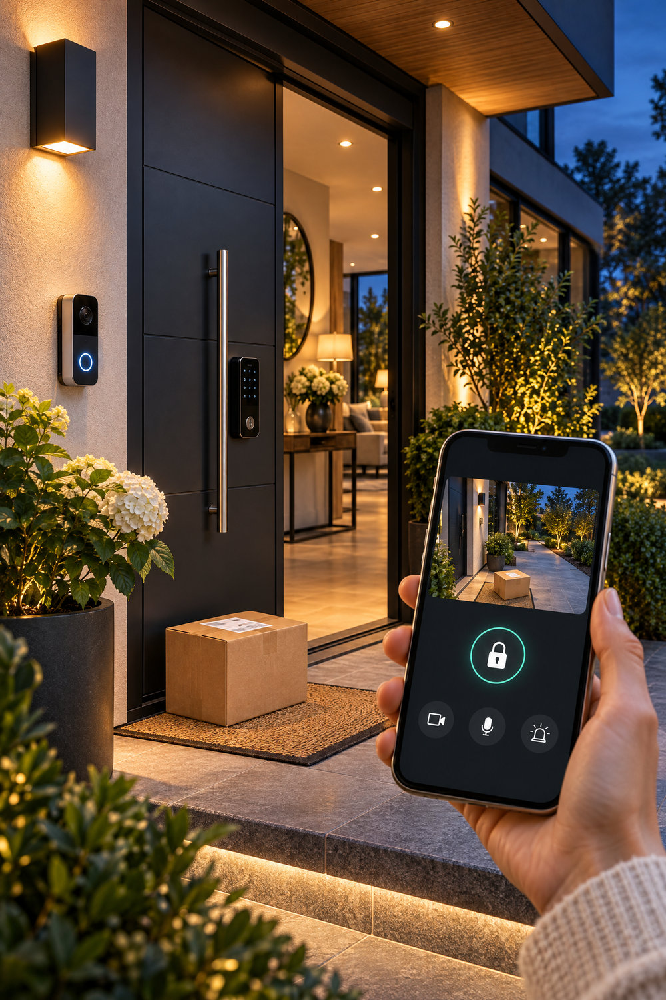
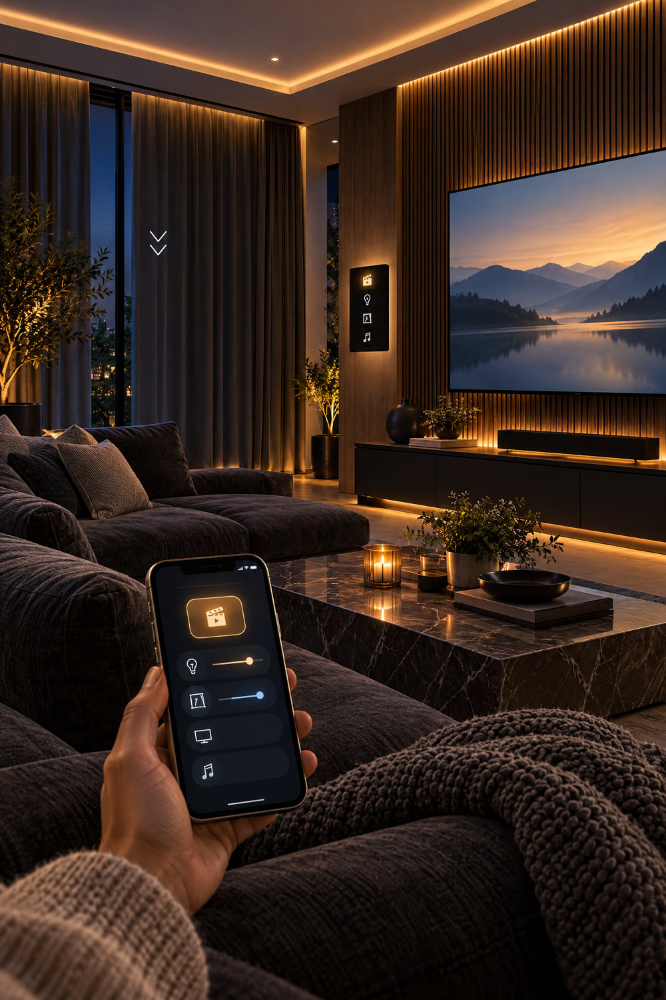
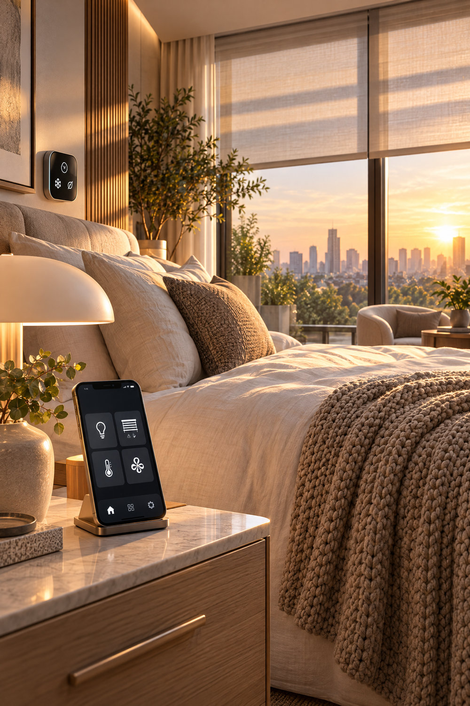
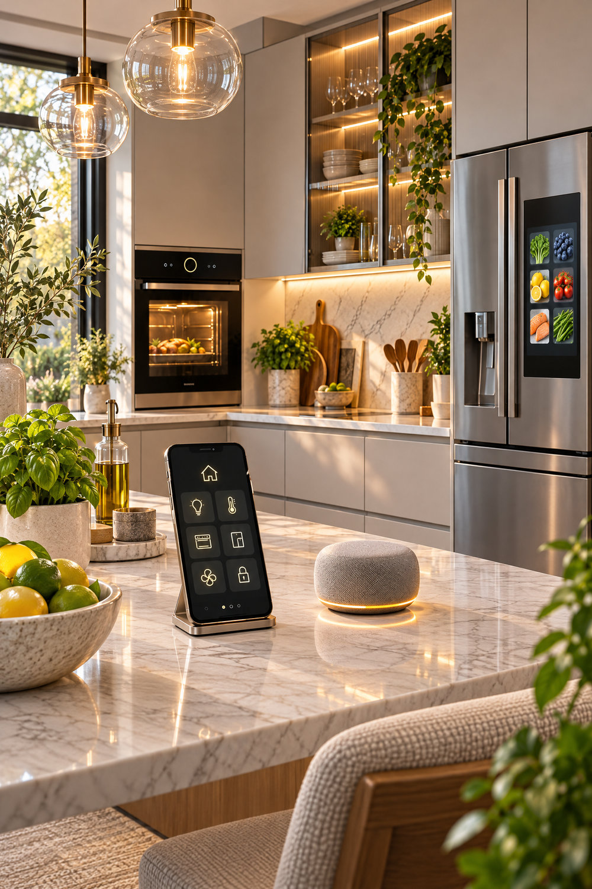
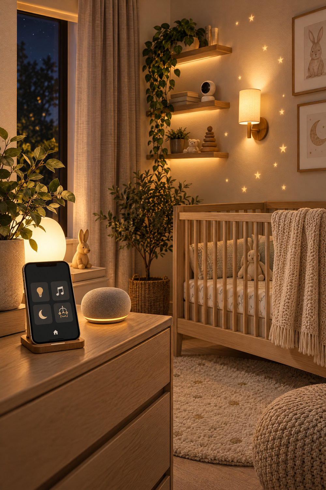
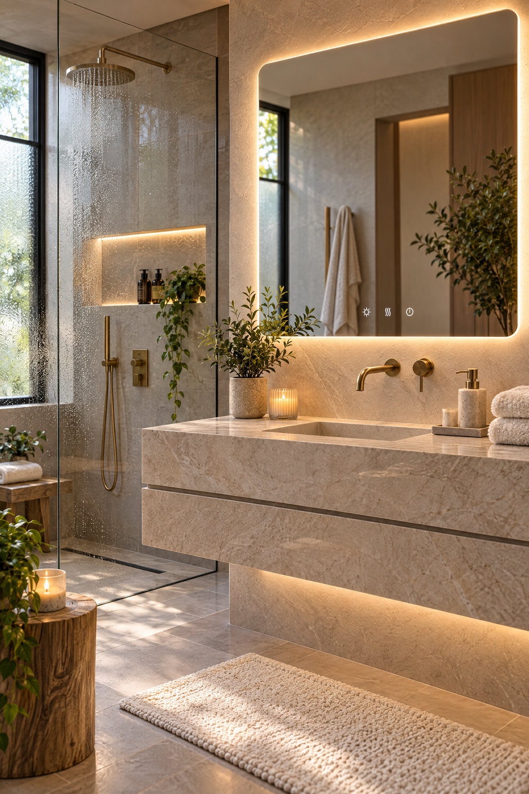
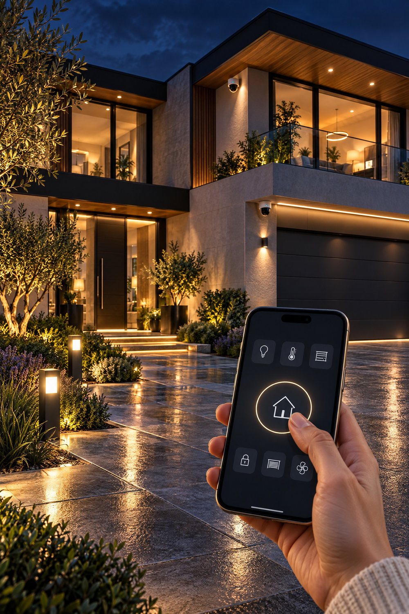
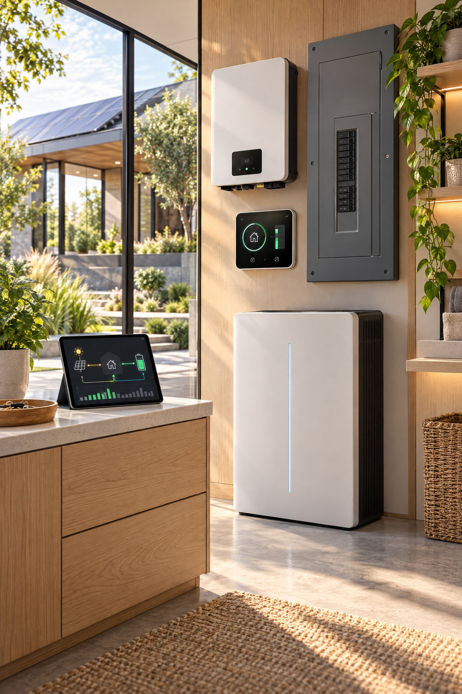

A beautiful smart home is not one with an app for every appliance. It is a home where entry feels predictable, lighting matches the moment, rooms remain comfortable, privacy is respected and the technology quietly supports what people already do.

Many smart-home inspiration photographs show a phone with a polished dashboard beside a warm modern interior. Treat those interfaces as **illustrations of a possible design approach**, not proof that any named device or app supports the precise functions shown. Before buying, verify compatibility, connectivity, local controls and installation requirements for the exact models.

## Start with your routines, not a device list

Walk through three real days in the household. Which steps cause repeated effort? Perhaps everyone uses the same front door, daylight glares across the home-office screen, the living-room lights are too bright for watching films, or a bedroom feels exposed before the blinds are closed.

For each proposed automation, write down the trigger, the expected action, the manual override and what should happen when Wi-Fi or power is unavailable.

| Daily moment | Useful possible action | Essential check |
| --- | --- | --- |
| Arriving home | Front-entry lighting and access status | Manual access, guest entry, fail-safe design |
| Working from home | Adjust shade and task lighting | Glare at the actual screen and desk |
| Preparing dinner | Brighten safe task lighting | Fixed suitable light levels at work surfaces |
| Watching a film | Dim decorative layers without darkening routes | Safe movement and accessible manual switching |
| Sleeping | Reduce unnecessary room lighting | Emergency visibility and dependable physical controls |
| Monitoring electricity | Display or compare usage | What the meter actually measures and how often |

This approach prevents the most expensive mistake: adding connected products without deciding whether the household needs the function.

## Arrival: smart access, doorbells and useful lighting

A considered smart entry combines three separate jobs: **access**, **knowing who is there** and **being able to see the approach**. A smart lock can be convenient, but no app should be the only practical way to enter your own home. Check the physical door and lock-body fit, backup access, battery replacement, permissions for guests and manufacturer support before choosing any system.

Video doorbells and cameras should be positioned to capture the actual approach rather than an empty doormat. Consider privacy boundaries and local recording rules, particularly where a camera could point into neighbours' private spaces. Lighting should help faces and steps remain visible without dazzling visitors or degrading camera images.

For these specifics, start with [Smart Access Control](/article/smart-access-control/) and [Discreet Security Cameras](/article/discreet-security-cameras/).

## Living-room scenes: plan light layers before controls

A dimmer is useful only if the room already has the right layers. Separate ambient light, practical task light and decorative accents. Then name a small number of scenes around real activities: *Welcome*, *Reading*, *Dinner* and *Movie*. Each scene should preserve safe navigation and a working physical switch.

A cinema scene need not plunge the room into total darkness. It may dim shelving and ceiling coves while keeping enough gentle light to move safely. Choose appropriate compatible dimmers and drivers; mains electrical work belongs with a qualified professional working to the relevant local requirements.

Our [Whole-Home Lighting Control Systems](/article/smart-home-lighting-control/) guide explains scene planning and system trade-offs in more detail.

## Bedrooms and home offices: let the blinds solve glare

Smart blinds are most useful when they respond to a known problem. A bedroom may need a repeatable morning routine and privacy; a home office may need fewer reflections on the screen during a particular part of the day. Record the window orientation, actual glare times and access to manual controls before selecting motors.

Motorised blinds require the correct tube, weight rating, power method and mounting details. A device advertised as compatible with a particular hub may still lack some of its advanced features. Verify the exact combination rather than assuming every blind will follow the sun or respond to voice commands.

See [Smart Blinds That Follow the Sun](/article/smart-blinds-follow-sun/) for practical planning questions.

## Connected kitchens: keep cooking and control separate

A refrigerator screen, phone dashboard or voice assistant can be visually striking, but the core kitchen still needs sensible circulation, cooking clearances, safe electrical placement and manual operation. Decide what you want to automate: perhaps lighting scenes or reminders, not simply adding connected equipment because it looks futuristic.

A kitchen controller should be placed away from heat, water and the main preparation spill zone. Check whether a voice assistant understands the actual household's needs and whether an appliance can still function appropriately without network access. The [Kitchen Design and Layout Guide](/article/kitchen-design-layout/) can help establish practical work zones first.

## Nursery and family comfort: keep safety independent of the app

It can be appealing to automate a warm evening light or view room temperature from a bedside device. Use these conveniences as information and comfort aids, **not as medical, safety or supervision substitutes**. Follow established safe-sleep guidance and your healthcare provider's recommendations for infants, rather than relying on a consumer app to decide whether a room is safe.

Keep cords and accessories well away from cots, choose age-appropriate equipment and protect camera feeds through secure credentials and updates. Be particularly careful about remote access and unnecessary audio or video retention. A manually operable night light is often preferable to a complicated scene that fails during a power or internet outage.

## Bathrooms: comfort, moisture and sensible automation

A softly illuminated mirror, timed fan and calm evening lighting may improve daily use, but bathrooms have strict practical constraints. Verify moisture protection, allowed electrical zones, ventilation, the exact product rating and professional installation requirements. A phone or wall controller pictured near a bath is a visual concept, **not an endorsement of using ordinary electronics in wet locations**.

Start with the functions you need: lighting appropriate for the mirror, a low-glare evening path and ventilation that operates reliably. Consider whether voice or app control actually adds convenience over a straightforward manual switch.

## Patios and garden security: separate the two goals

Smart outdoor lighting and security monitoring overlap, but they solve different problems. A garden lighting scene can make an evening lounge welcoming; a security setup needs well-considered entry coverage, lighting, alerts and privacy. Avoid pointing bright fixtures directly toward cameras. Confirm the weather suitability and power requirements of outdoor equipment.

Think about whether the camera sees the driveway approach, front door and relevant path, and whether lighting improves visibility. Always check recordings and alerts in actual nighttime conditions rather than assuming a polished app image proves coverage. See [Perimeter Monitoring](/article/perimeter-monitoring/) for the layered approach.

## Climate and energy: measure before automating

A thermostat can simplify a routine, but comfort and energy use depend on the building, equipment and household habits. Choose temperature and humidity controls compatible with your actual heating, cooling or ventilation system; never assume a connected dial can safely control any appliance.

An energy dashboard can help identify where power is consumed. It does **not** guarantee savings, and an attractive screen does not prove a metering device can measure every circuit. Verify whether the meter reports whole-home consumption, individual loads, solar generation or battery state, and whether data remains accessible when internet service is interrupted.

## Choose a small, reliable smart-home stack

Before purchasing, ask the supplier these questions:

1. **Compatibility:** What exact protocols, hubs and product versions are supported? Does the feature you want work across those exact versions?
2. **Offline fallback:** What still works during a network outage? Can occupants turn lights on, close blinds or open the door manually?
3. **Privacy:** Who can access event history, video, microphone or device data? Can you disable features you do not need?
4. **Updates:** Does the vendor disclose software and security update support? How will you maintain accounts and access permissions?
5. **Installation:** Does the exact device meet electrical, moisture, mechanical and local building requirements?
6. **Usefulness:** Does it remove a recurring inconvenience, or does it create another application that everyone must manage?

Some modest equipment may be worth evaluating if it solves a clearly established problem:

- <a href="https://steynenslin.s.gy/smart-dimmer" target="_blank" rel="sponsored noopener noreferrer">A compatible smart dimmer</a> for a planned, suitable lighting circuit; verify wiring, supported loads and qualified installation.
- <a href="https://steynenslin.s.gy/matter-zigbee-hub" target="_blank" rel="sponsored noopener noreferrer">A Matter/Zigbee gateway</a> if it genuinely supports the particular products and functions you want to combine.
- <a href="https://steynenslin.s.gy/roller-blind-motor" target="_blank" rel="sponsored noopener noreferrer">A motorised blind option</a> after checking tube dimensions, blind weight, power and control compatibility.
- <a href="https://steynenslin.s.gy/video-doorbell" target="_blank" rel="sponsored noopener noreferrer">A video doorbell</a> if entry sightlines, power, recording practices and privacy expectations suit your home.

*These product links may be affiliate links, meaning Veluce may earn a commission from a qualifying purchase. They are optional examples to compare, not recommendations to replace reliable existing equipment.*

## One-page smart-home brief before buying

Write one page with the room, daily moment, intended action, expected benefit, installation constraint, manual fallback and the device or system options you are considering. Prioritise the few changes that improve daily life most. Test one room properly before replicating the setup throughout the house.

If you want to coordinate lighting, window treatments, entry, climate and security as part of a wider design rather than unrelated gadgets, the [Complete Home Design System](/complete-home-design-system/) can help you connect those decisions with the whole-home brief, layout and product sourcing process.

## Explore More

**Browse the VELUCE shop →** [VELUCE Collection](https://tr.ee/Sp8jyc)

**Save ideas for later →** [VELUCE on Pinterest](https://www.pinterest.com/steynenslin/)
